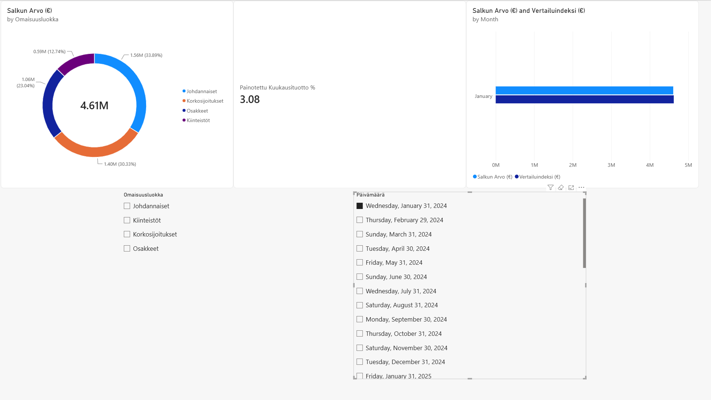
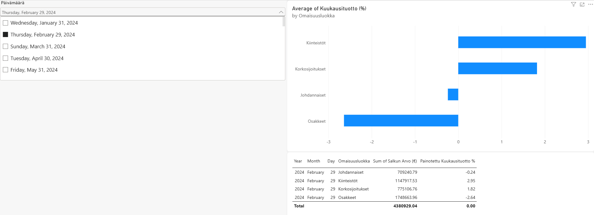

# Portfolio Analytics & Power BI Dashboard

Tässä projektissa on rakennettu yksinkertainen interaktiivinen sijoitussalkun raportointidashboard Power BI:llä. Projektissa simuloidaan ja analysoidaan eri omaisuuslajien (osakkeet, korkosijoitukset, kiinteistöt, johdannaiset) arvon kehitystä, allokaatiota ja painotettua tuottoa.

## Keskeiset ominaisuudet & Osaaminen
- **Tietomallinnus & Power Query:** Data piti tyypittää desimaaliluvuiksi.
- **DAX-laskenta:** Yksinkertainen dynaaminen mittari: salkun painotettu kuukausituotto (`Painotettu Kuukausituotto %`).
- **Visualisointi:** Interaktiiviset allokaatiokaaviot (Donut Chart) ja tuottokehityksen seuranta suodattimilla (Slicers).
- **Python:** Datan generointi ja simulointi Pythonilla (`pandas`, `numpy`).

## Dashboard-näkymä 1

## Dashboard-näkymä 2
